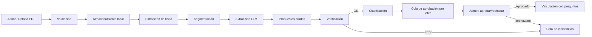

# Pipeline de IA: extracción, verificación y clasificación

**Fecha:** 2026-11-13  
**Especificación:** v1.1  
**Estado:** Propuesta para validación

---

## 1. Arquitectura del pipeline



---

## 2. Etapas detalladas

### 2.1 Validación de upload

**Responsable:** Endpoint admin de Nuxt.

**Validaciones:**
- MIME type real (no solo extensión): `application/pdf`, `text/html`.
- Tamaño máximo: 50 MB (configurable).
- Nombre de archivo sanitizado.
- Hash SHA-256 calculado y almacenado.
- Detección de duplicados por hash.

**Almacenamiento:**
- Path: `./storage/sources/{entity_id}/{timestamp}_{sanitized_name}.pdf`
- Permisos: lectura/escritura solo para el proceso de la app.
- Fuera del directorio público de Nuxt.

### 2.2 Extracción de texto

**Responsable:** `services/document-worker/extract.py`

**Herramientas:**
- PDF texto nativo: `pdfplumber` (preferido) o `PyMuPDF`.
- PDF escaneado: `pytesseract` con OCR (solo si se detecta).
- HTML: `BeautifulSoup` con limpieza de scripts y estilos.

**Salida:**
- Texto por página con localizadores.
- Estructura de secciones detectada (encabezados, listas).
- Tablas preservadas como texto estructurado.

**Esquema de salida:**

```json
{
  "source_id": "uuid",
  "pages": [
    {
      "page": 1,
      "text": "Texto completo de la página...",
      "sections": [
        {
          "heading": "1. Economía",
          "start_offset": 0,
          "end_offset": 1500
        }
      ]
    }
  ]
}
```

### 2.3 Segmentación

**Responsable:** `services/document-worker/extract.py`

**Principio:** La segmentación debe preservar el contexto completo de cada propuesta, incluyendo condiciones, excepciones y matices. **No se aplican límites arbitrarios de caracteres** que puedan fragmentar una propuesta en partes inconexas.

**Lógica:**
1. **División por secciones detectadas** (encabezados, artículos, apartados).
2. **Dentro de cada sección, división por párrafos completos** (delimitados por doble salto de línea o estructura del documento).
3. **Si un párrafo es excesivamente largo** (>2000 caracteres), se subdivide en puntos o subpárrafos, **nunca en medio de una oración**.
4. **Preservación de contexto:** Cada segmento incluye:
   - El texto completo del segmento.
   - El encabezado de la sección a la que pertenece.
   - Referencias a condiciones y excepciones mencionadas en el mismo segmento.
   - Localizador: página + offset de inicio y fin.

**Regla anti-fragmentación:** Si una propuesta detectada por el LLM abarca más de un segmento, el verificador fusiona los segmentos y registra la propuesta con el texto completo. No se trunca.

**Esquema de salida:**

```json
{
  "passages": [
    {
      "source_id": "uuid",
      "page": 1,
      "section": "1. Economía",
      "subsection": "1.1 Política fiscal",
      "start_offset": 0,
      "end_offset": 1200,
      "literal_text": "Texto exacto del segmento completo, incluyendo condiciones y excepciones...",
      "normalized_text": "Texto normalizado (minúsculas, sin acentos para búsqueda)"
    }
  ]
}
```

### 2.4 Extracción de propuestas con LLM

**Responsable:** `services/document-worker/extract.py` (llamada a LLM)

**Prompt template:**

```
Eres un analista de documentos políticos. Extrae propuestas concretas del siguiente texto.

Texto:
{passage_text}

Instrucciones:
1. Identifica propuestas, medidas o posiciones concretas.
2. Para cada propuesta, proporciona:
   - literal_text: cita exacta del texto original (máx. 200 caracteres)
   - normalized_text: descripción normalizada de la propuesta
   - conditions: condiciones o excepciones mencionadas
   - affected_area: área temática general
3. Solo extrae propuestas con contenido verificable.
4. No inventes, no infieras, no generalices.
5. Si no hay propuestas concretas, devuelve array vacío.

Salida en JSON:
{
  "claims": [
    {
      "literal_text": "...",
      "normalized_text": "...",
      "conditions": "...",
      "affected_area": "..."
    }
  ]
}
```

**Validación de salida:**
- Esquema JSON obligatorio.
- `literal_text` debe existir en el texto original (búsqueda de substring).
- `normalized_text` no puede estar vacío.

**Extracción por lotes:** No se aplica un límite máximo de propuestas por segmento. Un apartado puede contener más de diez medidas. Si el LLM devuelve un número elevado de propuestas, el extractor las procesa todas.

**Mecanismo de detección de contenido pendiente:**

1. **Campo `has_more` del LLM:** El LLM incluye un campo `has_more` en la respuesta indicando si detecta más propuestas en el segmento. Si `has_more = true`, se realiza una nueva llamada con instrucciones de continuar desde la última propuesta extraída.

2. **Comprobación independiente de cobertura:** No confiar exclusivamente en `has_more` generado por el LLM. Se implementa una verificación independiente:
   - **Cobertura por página:** Tras procesar todas las páginas del documento, se calcula el porcentaje de texto procesado que generó propuestas. Si una página tiene >500 caracteres de texto sin generar ninguna propuesta, se marca para revisión.
   - **Cobertura por sección:** Se verifica que cada sección del documento haya sido procesada. Las secciones sin propuestas se registran en `document_jobs.metadata`.
   - **Detección de huecos:** Si el offset de la última propuesta extraída está muy por delante del final del segmento (>30% del segmento sin procesar), se realiza una llamada adicional.
   - **Registro de cobertura:** Cada job registra en `document_jobs.metadata`:
     ```json
     {
       "pages_processed": 45,
       "pages_with_claims": 38,
       "pages_empty": 7,
       "sections_processed": 12,
       "sections_with_claims": 10,
       "total_claims": 156,
       "iterations_per_page": {"1": 1, "2": 2, "3": 1}
     }
     ```

3. **Límite de iteraciones:** El proceso se repite hasta que `has_more = false` **y** la comprobación independiente no detecte huecos significativos, o se alcance un máximo de iteraciones por segmento (configurable, default: 5).

4. **Registro en metadata:** Cada iteración se registra en `document_jobs.metadata` con el número de propuestas extraídas y la cobertura alcanzada.

**Configuración de LLM:**
- Proveedor principal: Anthropic (Claude).
- Fallback automático: OpenAI (solo ante errores recuperables).
- Modelo configurable por tarea.
- Temperatura baja (0.1) para consistencia.
- Timeout: 120 segundos por llamada.
- Registro de cada intento: proveedor, modelo, duración, error.

### 2.5 Verificación

**Responsable:** `services/document-worker/verify.py`

**Validaciones deterministas:**

| Validación | Descripción | Acción si falla |
|---|---|---|
| Cita existe | `literal_text` es substring del texto original | `needs_review` |
| Localizador correcto | Página y offset coinciden con la cita | `needs_review` |
| Propuesta no más amplia | `normalized_text` no añade contenido no presente | `needs_review` |
| Campos completos | Todos los campos obligatorios presentes | `needs_review` |
| Duplicado detectado | Propuesta similar ya existe (comparación de texto) | `ready_for_batch` con nota |
| Contradicción aparente | Propuesta opuesta a otra del mismo documento | `needs_review` |

**Verificación con LLM (opcional):**
- Prompt independiente para verificar que la propuesta refleja fielmente el texto.
- Modelo diferente al extractor (separación de responsabilidades).
- Resultado: `verified`, `questionable`, `rejected`.

### 2.6 Clasificación temática

**Responsable:** `services/document-worker/classify.py`

**Enfoque para MVP:**
- Taxonomía jerárquica predefinida (dimensiones → temas).
- Clasificación por reglas: palabras clave + patrones.
- Sugerencia por LLM opcional (no obligatoria).

**Taxonomía base:**

```
Economía
  ├── Política fiscal
  ├── Mercado laboral
  └── Comercio

Social
  ├── Sanidad
  ├── Educación
  └── Vivienda

Derechos
  ├── Derechos civiles
  └── Igualdad

Territorio
  └── Modelo de Estado

Instituciones
  ├── Sistema político
  └── Justicia

Medio ambiente
  ├── Cambio climático
  └── Energía
```

**Reglas de clasificación:**

```python
# Ejemplo simplificado
KEYWORD_MAP = {
    'economy.fiscal': ['impuesto', 'IVA', 'IRPF', 'fiscal', 'tributo'],
    'economy.labor': ['empleo', 'desempleo', 'salar', 'jornada', 'sindical'],
    'social.health': ['sanidad', 'salud', 'hospital', 'médico', 'cubrir'],
    # ...
}

def classify_by_keywords(normalized_text: str) -> List[str]:
    topics = []
    text_lower = normalized_text.lower()
    for topic, keywords in KEYWORD_MAP.items():
        if any(kw in text_lower for kw in keywords):
            topics.append(topic)
    return topics
```

**Clasificación por LLM (opcional):**
- Prompt con taxonomía completa.
- Salida: tema principal + temas secundarios.
- Solo sugerencia, no automática.

### 2.7 Cola de revisión

**Estructura en BD:**

```sql
-- Claims en cola de revisión
SELECT id, normalized_text, literal_text, status, topic_id, conditions
FROM claims
WHERE status IN ('ready_for_batch', 'needs_review')
ORDER BY created_at;
```

**Aprobación por lotes:**
- El admin selecciona un conjunto de claims (p. ej. todos de un documento con status `ready_for_batch`).
- Acción: `POST /api/admin/approvals/batch` con array de IDs.
- Resultado: todos cambian a `approved`, se registra en auditoría.

**Revisión individual:**
- Claims con status `needs_review` se revisan uno a uno.
- El admin puede: aceptar, modificar, rechazar o marcar como no comparable.
- Cada acción se registra en `editorial_audit`.

---

## 3. Configuración de proveedores LLM

### Estructura de configuración

```yaml
# services/document-worker/config.yaml
llm:
  providers:
    anthropic:
      api_key: ${ANTHROPIC_API_KEY}
      base_url: https://api.anthropic.com
      models:
        - name: claude-sonnet-4-20250514
          max_tokens: 4000
          temperature: 0.1
        - name: claude-haiku-20250414
          max_tokens: 1000
          temperature: 0.1
    openai:
      api_key: ${OPENAI_API_KEY}
      base_url: https://api.openai.com/v1
      models:
        - name: gpt-4o-mini
          max_tokens: 4000
          temperature: 0.1

tasks:
  extraction:
    default_provider: anthropic
    default_model: claude-sonnet-4-20250514
    fallback_provider: openai
    fallback_model: gpt-4o-mini
  verification:
    default_provider: anthropic
    default_model: claude-sonnet-4-20250514
    fallback_provider: openai
    fallback_model: gpt-4o-mini
  classification:
    default_provider: anthropic
    default_model: claude-haiku-20250414
    fallback_provider: openai
    fallback_model: gpt-4o-mini
```

### Adaptador de proveedores

```python
# services/document-worker/llm/__init__.py

from abc import ABC, abstractmethod

class LLMProvider(ABC):
    @abstractmethod
    async def complete(self, prompt: str, model: str, temperature: float) -> str:
        pass

    @abstractmethod
    def name(self) -> str:
        pass

class AnthropicProvider(LLMProvider):
    def __init__(self, config: dict):
        self.api_key = config['api_key']
        self.base_url = config['base_url']

    async def complete(self, prompt: str, model: str, temperature: float) -> str:
        # Implementación con Anthropic Messages API
        pass

class OpenAIProvider(LLMProvider):
    def __init__(self, config: dict):
        self.api_key = config['api_key']
        self.base_url = config['base_url']

    async def complete(self, prompt: str, model: str, temperature: float) -> str:
        # Implementación con OpenAI Chat Completions API
        pass

# Factory
def create_provider(name: str, config: dict) -> LLMProvider:
    providers = {
        'anthropic': AnthropicProvider,
        'openai': OpenAIProvider,
    }
    return providers[name](config)

# Fallback automático (solo errores recuperables)
async def call_with_fallback(task: str, prompt: str) -> dict:
    # 1. Intenta con Anthropic
    # 2. Si error recuperable (timeout, 5xx, 429), intenta con OpenAI
    # 3. Registra cada intento con proveedor, modelo, duración y error
    pass
```

---

## 4. Vinculación con preguntas

### Flujo

1. El admin crea preguntas en el banco (`questions`).
2. El admin asigna posiciones a entidades para cada pregunta (`positions`).
3. Las posiciones se vinculan con claims aprobados (`claim_id` en `positions`).
4. El verificador comprueba que la posición es consistente con la evidencia.

### Interfaz de asignación

```
Panel Admin → Preguntas → [Crear pregunta]
  ├── Texto canónico
  ├── Tema
  ├── Nivel de profundidad
  └── Opciones de respuesta

Panel Admin → Posiciones → [Asignar posición]
  ├── Entidad
  ├── Pregunta
  ├── Valor [-2, 2]
  ├── Estado (approved, conditional, etc.)
  ├── Evidencia (claim_id)
  └── Condiciones
```

---

## 5. Versionado de prompts y modelos

### Registro en BD

```sql
CREATE TABLE prompt_versions (
  id uuid PRIMARY KEY DEFAULT gen_random_uuid(),
  task text NOT NULL, -- 'extraction', 'verification', 'classification'
  version text NOT NULL, -- semver
  template text NOT NULL,
  model_name text NOT NULL,
  provider text NOT NULL,
  temperature numeric NOT NULL,
  created_at timestamp DEFAULT now()
);

CREATE TABLE document_job_metadata (
  job_id uuid PRIMARY KEY,
  prompt_version_id uuid REFERENCES prompt_versions(id),
  model_used text,
  provider_used text,
  cost numeric, -- si aplica
  latency_ms integer
);
```

### Trazabilidad

Cada claim extraído registra:
- `prompt_version_id` — versión del prompt usado.
- `model_name` — modelo concreto.
- `provider` — proveedor usado.
- `created_at` — instante de extracción.

---

## 6. Manejo de errores

| Error | Causa | Acción |
|---|---|---|
| PDF corrupto | Archivo dañado o no es PDF real | Estado `failed_pdf`, notificación al admin |
| OCR fallido | Imagen de baja calidad | Estado `failed_ocr`, sugerir documento alternativo |
| LLM timeout | Proveedor no responde en 60s | Estado `failed_llm`, reintento manual |
| LLM error | API no disponible, cuota agotada | Estado `failed_llm`, fallback a proveedor alternativo |
| Esquema inválido | LLM no devuelve JSON válido | Estado `failed_llm`, reintento con prompt ajustado |
| Cita no verificable | `literal_text` no encontrado en original | Estado `needs_review`, revisión humana obligatoria |

### Reintentos

- Los reintentos son manuales desde el panel admin.
- El admin puede cambiar el proveedor o modelo antes de reintentar.
- Se registra cada intento en `document_jobs`.

---

## 7. Seguridad del pipeline

### Aislamiento

- El worker Python no tiene acceso a internet salvo a los endpoints LLM configurados.
- Los PDFs se procesan en memoria, no se ejecutan scripts ni macros.
- El worker no tiene acceso a rutas de la app Nuxt.

### Validación de entradas

- Los prompts se templatean, no se concatenan strings de usuario.
- Los textos extraídos se sanitizan antes de almacenar.
- Los outputs del LLM se validan contra esquema JSON estricto.

### Logs

- Los logs del worker no incluyen contenido de respuestas de usuarios.
- Los logs incluyen: job_id, source_id, etapa, estado, duración, error.
- Los prompts y responses del LLM se registran solo en modo debug (desactivado en producción).
