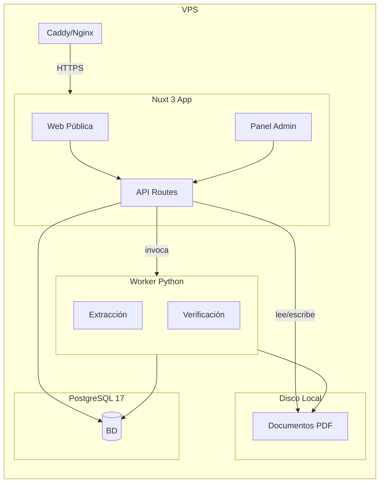
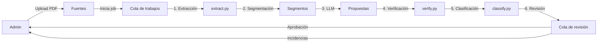

# Arquitectura propuesta

**Fecha:** 2026-11-13  
**Especificación:** v1.1  
**Estado:** Propuesta para validación

---

## 1. Arquitectura general



### Decisiones clave

1. **Monolito Nuxt con admin integrado** — Una única app Nuxt 3 con rutas públicas (`/`) y admin (`/admin`). Simplifica despliegue, mantenimiento y desarrollo. No requiere monorepo complejo para MVP.

2. **Worker Python como proceso hijo** — La API Nuxt invoca scripts Python mediante `child_process` o `execa`. La cola de trabajos se gestiona en PostgreSQL con estados. Sin servicio distribuido.

3. **Documentos en disco local** — Carpeta fuera del directorio público del proyecto. Acceso controlado por permisos del sistema de archivos. Sin S3, MinIO ni almacenamiento de objetos.

4. **Sin pgvector en MVP** — Clasificación temática por taxonomía jerárquica y búsqueda por texto completo de PostgreSQL. pgvector se añade cuando se demuestre necesidad.

5. **Scoring 100% en navegador** — Paquete TypeScript puro ejecutado en cliente. El servidor solo entrega datos de releases publicados. Incluye calibración de prioridades (comparaciones por pares) ejecutada íntegramente en el navegador.

6. **Calibración de prioridades** — Tres modos (seria, rápida, omitida). El modo serio utiliza comparaciones por pares con selección adaptativa. Los pesos se guardan en la exportación y se reproducen al importar.

---

## 2. Estructura del proyecto

```
affinity-platform/
├── apps/
│   └── web/                      # Nuxt 3 app (pública + admin)
│       ├── assets/
│       ├── components/
│       │   ├── common/           # Componentes compartidos
│       │   ├── survey/           # Catálogo, encuesta, resultados
│       │   └── admin/            # Panel de administración
│       ├── composables/          # Lógica reactiva
│       ├── pages/
│       │   ├── index.vue         # Catálogo público
│       │   ├── survey/           # Encuestas
│       │   │   ├── [slug].vue    # Detalle de encuesta
│       │   │   ├── take.vue      # Responder encuesta
│       │   │   └── results.vue   # Resultados
│       │   ├── history.vue       # Mis encuestas (local)
│       │   └── admin/            # Panel admin (protegido)
│       │       ├── login.vue
│       │       ├── dashboard.vue
│       │       ├── entities.vue
│       │       ├── documents.vue
│       │       ├── review.vue
│       │       ├── questions.vue
│       │       └── publish.vue
│       ├── server/               # API routes de Nuxt
│       │   ├── api/
│       │   │   ├── surveys/      # Catálogo público
│       │   │   ├── releases/     # Releases publicados
│       │   │   ├── positions/    # Posiciones y evidencia
│       │   │   ├── sources/      # Metadatos de fuentes
│       │   │   └── admin/        # Endpoints admin (autenticados)
│       │   └── utils/
│       ├── stores/               # Pinia stores
│       ├── i18n/                 # Traducciones
│       │   └── locales/
│       │       └── es.json
│       ├── lib/
│       │   ├── scoring/          # Motor de scoring (TS puro)
│       │   ├── storage/          # IndexedDB wrapper
│       │   └── export/           # Exportación/importación JSON
│       ├── nuxt.config.ts
│       └── tsconfig.json
├── services/
│   └── document-worker/          # Python: extracción y análisis
│       ├── extract.py            # Extracción de PDF/HTML
│       ├── classify.py           # Clasificación temática
│       ├── verify.py             # Verificación de citas
│       ├── requirements.txt
│       └── config.yaml
├── db/
│   ├── migrations/               # Migraciones SQL versionadas
│   │   ├── 001_initial.sql
│   │   ├── 002_questions.sql
│   │   └── 003_releases.sql
│   └── seeds/                    # Datos iniciales
├── docs/                         # Documentación del proyecto
│   ├── specification-review.md
│   ├── architecture.md
│   ├── data-model.md
│   ├── scoring-methodology.md
│   ├── ai-pipeline.md
│   ├── privacy-security.md
│   ├── implementation-roadmap.md
│   ├── backlog.md
│   ├── technical-spikes.md
│   └── open-decisions.md
├── storage/                      # Documentos originales (no en git)
│   └── .gitkeep
├── docker-compose.yml
├── Dockerfile.web
├── Dockerfile.worker
├── package.json
└── README.md
```

---

## 3. Límites entre capas

### Frontend (Nuxt 3, Vue, TypeScript)
- Catálogo público de encuestas.
- Flujo de respuesta: selección de entidades, modalidad, preguntas, revisión, resultados.
- Historial local en IndexedDB.
- Exportación/importación JSON.
- Panel de administración: CRUD de entidades, documentos, propuestas, preguntas, posiciones, publicación.
- **Scoring:** cálculo completo en navegador.

### Backend (Nuxt Server Routes, TypeScript)
- API pública: entrega de contenido publicado (encuestas, releases, posiciones, evidencia).
- API admin: autenticación, CRUD, pipeline documental, publicación.
- **No recibe ni guarda respuestas individuales.**
- **No calcula scoring.**
- **Acceso a BD:** consultas SQL parametrizadas con `pg` (node-postgres). Sin ORM. Migraciones con `node-pg-migrate`.
- **Releases inmutables:** el endpoint `/api/releases/:id` lee exclusivamente `manifest_jsonb` congelado en el momento de la publicación. La inmutabilidad se garantiza mediante:
  - Trigger SQL que impide UPDATE/DELETE de releases publicados.
  - Restricción CHECK que valida `manifest_hash` contra `manifest_jsonb`.
  - Transacción atómica de publicación.

### Worker documental (Python)
- Extracción de texto de PDF/HTML.
- Segmentación por páginas/secciones.
- Extracción de propuestas con LLM configurable.
- Verificación de citas contra documento original.
- Clasificación temática sugerida.
- **No publica nada directamente.** Escribe en cola de revisión en BD.

---

## 4. Contratos de API

### API Pública (sin autenticación)

| Método | Ruta | Descripción |
|---|---|---|
| GET | `/api/surveys` | Catálogo de encuestas publicadas |
| GET | `/api/surveys/:slug` | Detalle de encuesta |
| GET | `/api/releases/:id` | Snapshot completo de release (preguntas, posiciones, evidencia, scoring model) |
| GET | `/api/sources/:id/metadata` | Metadatos públicos de fuente (sin PDF) |

### API Admin (autenticada)

| Método | Ruta | Descripción |
|---|---|---|
| POST | `/api/admin/auth/login` | Solicitar código OTP por email |
| POST | `/api/admin/auth/verify` | Verificar código OTP e iniciar sesión |
| POST | `/api/admin/auth/logout` | Cerrar sesión |
| GET | `/api/admin/entities` | Listar entidades |
| POST | `/api/admin/entities` | Crear entidad |
| PUT | `/api/admin/entities/:id` | Actualizar entidad |
| POST | `/api/admin/sources` | Upload de documento |
| POST | `/api/admin/sources/:id/process` | Iniciar extracción |
| GET | `/api/admin/review-queue` | Propuestas pendientes |
| POST | `/api/admin/approvals/batch` | Aprobar por lote |
| POST | `/api/admin/approvals/single` | Aprobar/rechazar individual |
| GET | `/api/admin/questions` | Banco de preguntas |
| POST | `/api/admin/questions` | Crear pregunta |
| PUT | `/api/admin/questions/:id` | Actualizar pregunta |
| POST | `/api/admin/questions/:id/positions` | Asignar posición |
| GET | `/api/admin/surveys/:id/preview` | Previsualización |
| POST | `/api/admin/surveys/:id/publish` | Publicar release |
| GET | `/api/admin/audit` | Registro de auditoría |

### Prohibido en MVP
- POST de respuestas/resultados a cualquier endpoint.
- Guardado de encuestas personales en servidor.
- Registro público o email a visitantes.

---

## 5. Sistema de autenticación administrativa

### OTP por email con Brevo (confirmado)

**Decisión:** Autenticación administrativa mediante código OTP de 6 dígitos enviado por email, utilizando Brevo en su plan gratuito.

**Implementación propuesta:**
- Proveedor SMTP: Brevo (plan gratuito, 100 emails/día).
- Código OTP: 6 dígitos, caducidad 10 minutos.
- Límite de intentos: 5 intentos fallidos → bloqueo 15 minutos.
- Sesión: cookie `HttpOnly`, `Secure`, `SameSite=Strict` con rotación cada 24 horas.
- **Solo para administración.** Sin cuentas, email ni registro para visitantes.

**Seguridad:**
- Rate limiting en endpoint de login.
- Registro de intentos fallidos en `editorial_audit`.
- Notificación por email al iniciar sesión desde nueva IP.
- Códigos de un solo uso: el OTP se invalida tras su primer uso exitoso.

**Modelo de datos:**
- `admin_credentials`: email del administrador.
- `admin_sessions`: token de sesión, OTP activo, caducidad, intentos fallidos, bloqueo temporal.

---

## 6. Pipeline de IA



### Etapas detalladas

1. **Ingesta:** Validación MIME, tamaño máximo (50 MB), hash SHA-256, almacenamiento en disco local.
2. **Extracción:** `pdfplumber` o `PyMuPDF` para texto nativo. `pytesseract` para OCR si es necesario. Preservación de páginas y estructura.
3. **Segmentación:** División por secciones/párrafos con localizadores (página, artículo).
4. **Extracción LLM:** Prompt configurable con esquema JSON de salida. Cita obligatoria. Condiciones y excepciones.
5. **Verificación:** Validación determinista de citas contra texto extraído. Detección de duplicados y contradicciones.
6. **Clasificación:** Taxonomía jerárquica. Sugerencia de tema por reglas + LLM opcional.
7. **Revisión:** Cola en BD. Aprobación por lotes o individual. Auditoría completa.

### Configuración de LLM

```yaml
# services/document-worker/config.yaml
llm:
  primary_provider: anthropic
  primary_api_key: ${ANTHROPIC_API_KEY}
  fallback_provider: openai
  fallback_api_key: ${OPENAI_API_KEY}
tasks:
  extraction:
    primary_model: claude-sonnet-4-20250514
    fallback_model: gpt-4o-mini
    temperature: 0.1
  verification:
    primary_model: claude-sonnet-4-20250514
    fallback_model: gpt-4o-mini
    temperature: 0.0
  classification:
    primary_model: claude-haiku-20250414
    fallback_model: gpt-4o-mini
    temperature: 0.1
```

---

## 7. Sistema de publicación y versionado

### Releases inmutables

Un release es un snapshot congelado que incluye:
- `survey_id` y `release_version` (semántico: `1.0.0`).
- `manifest_jsonb`: JSON completo con preguntas, posiciones, evidencias y entidades en el momento de la publicación.
- `manifest_hash`: SHA-256 de `manifest_jsonb`.
- Referencia al modelo de scoring (`scoring_model_id` + `version`).

**Garantía de inmutabilidad:**
- El endpoint `/api/releases/:id` lee exclusivamente `manifest_jsonb`, no hace JOIN con tablas editables.
- Si el admin edita una pregunta o posición después de publicar, el cambio afecta solo a nuevos releases.
- Los resultados históricos de una encuesta nunca cambian cuando el admin modifica contenido.
- **A nivel de base de datos:** trigger SQL impide modificación de releases publicados, restricción CHECK valida el hash del manifiesto, transacción atómica de publicación. Ver `data-model.md`, sección 5.

### Flujo de publicación

1. Admin prepara release en estado `draft`.
2. Validación automática: todas las posiciones tienen evidencia aprobada.
3. Previsualización: matriz de cobertura por entidad/dimensión.
4. Publicación: genera hash inmutable, cambia estado a `published`.
5. Los resultados antiguos se conservan con el release original.
6. Despublicación: cambia estado a `archived`, no modifica el release.

### Versionado del algoritmo

- El modelo de scoring tiene versión semántica independiente.
- Cada release referencia una versión concreta.
- Los resultados guardados localmente incluyen `scoring_model_version`.
- El recalculo con una nueva versión es una acción explícita.

---

## 8. Gestión de errores y procesamiento asíncrono

### Estados de trabajos documentales

| Estado | Descripción |
|---|---|
| `pending` | Esperando ejecución |
| `extracting` | Extracción en curso |
| `extracted` | Texto extraído |
| `classifying` | Clasificación en curso |
| `verifying` | Verificación en curso |
| `completed` | Finalizado, en cola de revisión |
| `failed_pdf` | Error de extracción de PDF |
| `failed_llm` | Error de LLM |
| `failed_verify` | Error de verificación |
| `timeout` | Tiempo de espera excedido |

### Manejo de errores

- **PDF corrupto:** Estado `failed_pdf`, mensaje de error en admin, opción de reintentar.
- **LLM no disponible:** Estado `failed_llm`, cola de reintentos manuales.
- **Timeout:** 30 minutos máximo por documento. Estado `timeout`.
- **Cita no verificable:** Propuesta marcada `needs_review`, no se aprueba automáticamente.

### Cola de trabajos

- Tabla `document_jobs` en PostgreSQL.
- Estados actualizados por el worker al completar cada etapa.
- El admin ve el estado en tiempo real (polling cada 5 segundos).
- Sin cola distribuida en MVP.

---

## 9. Estrategia de despliegue con Docker Compose

### docker-compose.yml

```yaml
version: '3.8'

services:
  web:
    build:
      context: .
      dockerfile: Dockerfile.web
    ports:
      - "3000:3000"
    environment:
      - DATABASE_URL=postgresql://app:password@db:5432/affinity
      - STORAGE_PATH=/app/storage
      - WORKER_SCRIPT=/app/services/document-worker/extract.py
    volumes:
      - ./storage:/app/storage
    depends_on:
      - db

  db:
    image: postgres:17-alpine
    ports:
      - "5432:5432"
    environment:
      - POSTGRES_DB=affinity
      - POSTGRES_USER=app
      - POSTGRES_PASSWORD=password
    volumes:
      - pgdata:/var/lib/postgresql/data
      - ./db/migrations:/docker-entrypoint-initdb.d

volumes:
  pgdata:
```

### Reverse proxy (Caddy)

```
# Caddyfile
affinity.example.com {
  reverse_proxy web:3000
  encode gzip
  tls admin@example.com
}
```

### Backups

- Script simple de backup: `pg_dump` + copia de `storage/`.
- Frecuencia: semanal (configurable).
- Almacenamiento: disco local del VPS o disco externo.
- Restauración probada al menos una vez antes de producción.

---

## 10. Internacionalización

### Arquitectura i18n

- `@nuxtjs/i18n` para gestión de idiomas.
- Idioma por defecto: `es-ES`.
- Fallback: castellano cuando falta traducción.
- Textos de interfaz en archivos JSON por idioma.
- Contenido traducible (preguntas, propuestas) en tablas separadas con `locale`.

### Estructura de traducciones

```
apps/web/i18n/locales/
├── es.json          # Castellano (completo)
├── ca.json          # Catalán/valenciano (futuro)
├── gl.json          # Gallego (futuro)
└── eu.json          # Euskera (futuro)
```

### Reglas

- Las traducciones no alteran el scoring.
- Las traducciones de preguntas y propuestas son versionadas.
- El texto original se conserva siempre.
- Solo se activan idiomas con traducciones revisadas.
