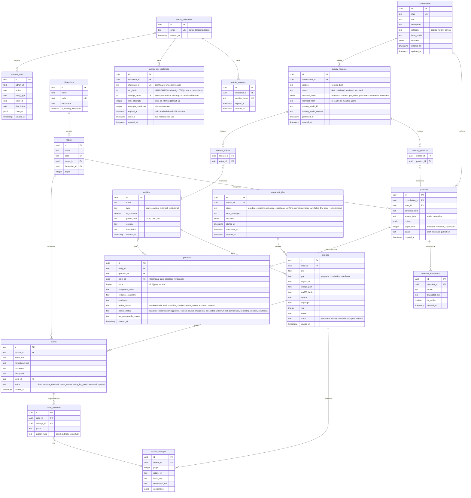

# Modelo de datos PostgreSQL

**Fecha:** 2026-11-13  
**Especificación:** v1.1  
**Base de datos:** PostgreSQL 17

---

## 1. Diagrama ER



---

## 2. Tablas simplificadas para MVP

Las tablas marcadas con ⏭️ se posponen hasta que sean necesarias.

### Tablas del MVP

| Tabla | Función | Notas |
|---|---|---|
| `consultations` | Encuestas | `category` en lugar de tabla `universes` |
| `entities` | Partidos, históricos | `is_historical` + `period_label` simplificado |
| `sources` | Documentos originales | Hash SHA-256, path local |
| `source_passages` | Pasajes con localizador | Página, artículo, texto literal |
| `claims` | Propuestas extraídas | Con estado editorial |
| `claim_evidence` | Evidencia de propuestas | Cita + pasaje |
| `topics` | Taxonomía temática | Jerárquica con `parent_id` |
| `dimensions` | Dimensiones de scoring | Agrupación de temas |
| `questions` | Banco de preguntas | Con `depth_level` |
| `question_translations` ⏭️ | Traducciones de preguntas | Solo si hay múltiples idiomas activos |
| `positions` | Posiciones entidad-pregunta | Con evidencia y estado |
| `survey_releases` | Releases publicados | Snapshot inmutable |
| `release_questions` | Preguntas de release | Relación N:N |
| `release_entities` | Entidades de release | Relación N:N |
| `document_jobs` | Trabajos de procesamiento | Con estados detallados |
| `editorial_audit` | Auditoría editorial | Todas las acciones admin |
| `admin_credentials` | Credenciales admin | Email del administrador para OTP |
| `admin_sessions` | Sesiones admin autenticadas | Token seguro, expiración |
| `admin_otp_challenges` | Desafíos OTP | Hash HMAC, intentos, caducidad, un solo uso |

### Tablas pospuestas

| Tabla | Razón de posponer |
|---|---|
| `universes` | Usar `category` en `consultations` para MVP |
| `entity_versions` | Usar `period_label` simplificado para MVP |
| `question_translations` | Solo castellano en lanzamiento |
| `prompt_versions` | Registrar versión de prompt en `document_jobs.metadata` (JSONB) para MVP |
| `document_job_metadata` | Usar `document_jobs.metadata` (JSONB) para MVP |

---

## 3. Restricciones y claves

### Claves primarias
- Todas las tablas usan `uuid` como PK.
- Generación con `gen_random_uuid()` de PostgreSQL.

### Claves únicas
- `consultations.slug` — identificador público de encuesta.
- `topics.code` — código único de tema.
- `dimensions.code` — código único de dimensión.
- `admin_credentials.email` — correo del administrador.
- `admin_sessions.session_token` — token de sesión.

### Claves foráneas con cascada

| Relación | Acción ON DELETE |
|---|---|
| `sources.entity_id` → `entities.id` | CASCADE |
| `source_passages.source_id` → `sources.id` | CASCADE |
| `claims.source_id` → `sources.id` | CASCADE |
| `claim_evidence.claim_id` → `claims.id` | CASCADE |
| `claim_evidence.passage_id` → `source_passages.id` | CASCADE |
| `questions.consultation_id` → `consultations.id` | CASCADE |
| `positions.entity_id` → `entities.id` | CASCADE |
| `positions.question_id` → `questions.id` | CASCADE |
| `survey_releases.consultation_id` → `consultations.id` | RESTRICT |
| `document_jobs.source_id` → `sources.id` | CASCADE |
| `admin_sessions.credential_id` → `admin_credentials.id` | CASCADE |
| `admin_otp_challenges.credential_id` → `admin_credentials.id` | CASCADE |

### Restricciones de datos

- `sources.sha256_hash` — formato hex de 64 caracteres.
- `positions.value` — rango `[-2, 2]` para escala.
- `survey_releases.version` — formato semántico (`X.Y.Z`).
- `survey_releases.manifest_hash` — SHA-256 del manifest completo.
- `sources.status` — valores enumerados.
- `claims.status` — valores enumerados.
- `questions.status` — valores enumerados.
- `positions.review_status` — valores enumerados: `draft`, `machine_checked`, `needs_review`, `approved`, `rejected`.
- `positions.stance_status` — valores enumerados: `approved`, `explicit_neutral`, `ambiguous`, `not_stated`, `unknown`, `not_comparable`, `conflicting_sources`, `conditional`.
- `document_jobs.status` — valores enumerados.

---

## 4. Índices propuestos

```sql
-- Búsqueda rápida por slug
CREATE INDEX idx_consultations_slug ON consultations(slug);

-- Filtrado de releases publicados
CREATE INDEX idx_survey_releases_status ON survey_releases(status);

-- Búsqueda de posiciones por entidad
CREATE INDEX idx_positions_entity ON positions(entity_id);

-- Búsqueda de posiciones por pregunta
CREATE INDEX idx_positions_question ON positions(question_id);

-- Filtrado de posiciones aprobadas
CREATE INDEX idx_positions_review_status ON positions(review_status) WHERE review_status = 'approved';

-- Búsqueda de claims por estado
CREATE INDEX idx_claims_status ON claims(status);

-- Búsqueda de fuentes por entidad
CREATE INDEX idx_sources_entity ON sources(entity_id);

-- Búsqueda de trabajos por estado
CREATE INDEX idx_document_jobs_status ON document_jobs(status);

-- Auditoría reciente
CREATE INDEX idx_editorial_audit_created ON editorial_audit(created_at DESC);

-- Sesiones activas
CREATE INDEX idx_admin_sessions_token ON admin_sessions(session_token);
CREATE INDEX idx_admin_sessions_expires ON admin_sessions(expires_at);

-- Desafíos OTP
CREATE INDEX idx_admin_otp_attempt ON admin_otp_challenges(attempt_token);
CREATE INDEX idx_admin_otp_expires ON admin_otp_challenges(expires_at);
```

---

## 5. Inmutabilidad de releases publicados

Un release publicado **no puede modificarse**. Las reglas de inmutabilidad son:

1. **`survey_releases`**: Una vez en estado `published`, no se permite UPDATE ni DELETE. Solo se puede cambiar a `archived`.
2. **`release_questions`** y **`release_entities`** : No se modifican tras publicación.
3. **Las preguntas y posiciones originales** pueden editarse, pero el release conserva los valores snapshot. Para garantizar esto, el endpoint público `/api/releases/:id` devuelve los datos congelados en el momento de la publicación, no los datos actuales de las tablas `questions` y `positions`.

**Implementación a nivel de aplicación:**
- Al publicar, se genera un manifest JSON con todos los datos necesarios (preguntas, posiciones, evidencias, entidades) y se almacena en un campo `manifest_jsonb` en `survey_releases`.
- El campo `manifest_hash` es el SHA-256 de `manifest_jsonb`.
- El endpoint `/api/releases/:id` lee exclusivamente `manifest_jsonb`, no hace JOIN con tablas editables.
- Si el admin edita una pregunta o posición después de publicar, el cambio afecta solo a nuevos releases.

**Implementación a nivel de base de datos:**

```sql
-- Extensión para funciones de hash
CREATE EXTENSION IF NOT EXISTS pgcrypto;

-- Trigger UPDATE: permitir exclusivamente published → archived sin modificar campos protegidos
CREATE OR REPLACE FUNCTION enforce_release_immutability()
RETURNS TRIGGER AS $$
BEGIN
  -- Transición draft → published: exigir manifest_jsonb y manifest_hash no nulos
  IF OLD.status = 'draft' AND NEW.status = 'published' THEN
    IF NEW.manifest_jsonb IS NULL THEN
      RAISE EXCEPTION 'Cannot publish without manifest_jsonb';
    END IF;
    IF NEW.manifest_hash IS NULL THEN
      RAISE EXCEPTION 'Cannot publish without manifest_hash';
    END IF;
    -- Validar hash contra manifiesto
    IF NEW.manifest_hash != encode(digest(jsonb_build_object(
      'questions', NEW.manifest_jsonb->'questions',
      'entities', NEW.manifest_jsonb->'entities',
      'positions', NEW.manifest_jsonb->'positions',
      'evidence', NEW.manifest_jsonb->'evidence'
    )::text, 'sha256'), 'hex') THEN
      -- Validación alternativa: hash del manifiesto completo serializado
      IF NEW.manifest_hash != encode(digest(
        jsonb_strip_nulls(NEW.manifest_jsonb)::text, 'sha256'
      ), 'hex') THEN
        RAISE EXCEPTION 'manifest_hash does not match manifest_jsonb';
      END IF;
    END IF;
    RETURN NEW;
  END IF;

  -- Transición published → archived: solo permitir cambio de status y archived_at
  IF OLD.status = 'published' AND NEW.status = 'archived' THEN
    -- Verificar que solo cambian status y archived_at (si existe)
    IF OLD.manifest_jsonb IS DISTINCT FROM NEW.manifest_jsonb THEN
      RAISE EXCEPTION 'Cannot modify manifest_jsonb during archiving';
    END IF;
    IF OLD.manifest_hash IS DISTINCT FROM NEW.manifest_hash THEN
      RAISE EXCEPTION 'Cannot modify manifest_hash during archiving';
    END IF;
    IF OLD.version IS DISTINCT FROM NEW.version THEN
      RAISE EXCEPTION 'Cannot modify version during archiving';
    END IF;
    IF OLD.published_at IS DISTINCT FROM NEW.published_at THEN
      RAISE EXCEPTION 'Cannot modify published_at during archiving';
    END IF;
    RETURN NEW;
  END IF;

  -- Impedir cualquier otra modificación a published o archived
  IF OLD.status IN ('published', 'archived') THEN
    RAISE EXCEPTION 'Cannot modify a published or archived release. Current status: %', OLD.status;
  END IF;

  RETURN NEW;
END;
$$ LANGUAGE plpgsql;

CREATE TRIGGER trg_release_immutability
  BEFORE UPDATE ON survey_releases
  FOR EACH ROW
  EXECUTE FUNCTION enforce_release_immutability();

-- Trigger DELETE: impedir eliminación de releases publicados y archivados
CREATE OR REPLACE FUNCTION prevent_release_delete()
RETURNS TRIGGER AS $$
BEGIN
  IF OLD.status IN ('published', 'archived') THEN
    RAISE EXCEPTION 'Cannot delete a published or archived release';
  END IF;
  RETURN OLD;
END;
$$ LANGUAGE plpgsql;

CREATE TRIGGER trg_prevent_release_delete
  BEFORE DELETE ON survey_releases
  FOR EACH ROW
  EXECUTE FUNCTION prevent_release_delete();

-- Restricción CHECK: manifest_jsonb y manifest_hash obligatorios al publicar
ALTER TABLE survey_releases
  ADD CONSTRAINT chk_published_manifest_required
  CHECK (
    status != 'published' OR
    (manifest_jsonb IS NOT NULL AND manifest_hash IS NOT NULL)
  );

-- Restricción CHECK: validar formato de manifest_hash (64 caracteres hex)
ALTER TABLE survey_releases
  ADD CONSTRAINT chk_manifest_hash_format
  CHECK (
    manifest_hash IS NULL OR
    manifest_hash ~ '^[0-9a-f]{64}$'
  );
```

**Transacción de publicación:**

```sql
BEGIN;
  -- 1. Validar que todas las posiciones tienen evidencia aprobada
  -- 2. Generar manifest_jsonb con snapshot completo
  -- 3. Calcular manifest_hash = SHA-256(jsonb_strip_nulls(manifest_jsonb))
  -- 4. Actualizar estado a 'published' y published_at
  -- 5. Registrar en auditoría
  -- 6. COMMIT (atómico)
COMMIT;
```

**Comprobación de integridad del manifiesto:**

```sql
-- Verificar que todos los releases publicados tienen hash válido
SELECT id, version, status
FROM survey_releases
WHERE status IN ('published', 'archived')
  AND (
    manifest_jsonb IS NULL
    OR manifest_hash IS NULL
    OR manifest_hash != encode(digest(
      jsonb_strip_nulls(manifest_jsonb)::text, 'sha256'
    ), 'hex')
  );
-- Debe devolver 0 filas
```

**Pruebas de validación en PostgreSQL 17 real:**

```sql
-- Preparación
CREATE EXTENSION IF NOT EXISTS pgcrypto;

-- Crear tabla mínima para pruebas
CREATE TABLE survey_releases (
  id uuid PRIMARY KEY DEFAULT gen_random_uuid(),
  consultation_id uuid,
  version text,
  status text CHECK (status IN ('draft', 'validated', 'published', 'archived')),
  manifest_jsonb jsonb,
  manifest_hash text,
  published_at timestamp,
  created_at timestamp DEFAULT now()
);

-- Aplicar triggers (ver arriba)

-- === PRUEBA 1: Crear release en draft ===
INSERT INTO survey_releases (consultation_id, version, status)
VALUES ('a0000000-0000-0000-0000-000000000001', '1.0.0', 'draft')
RETURNING id;
-- OK: se crea sin manifest

-- === PRUEBA 2: Publicar sin manifest (debe fallar) ===
UPDATE survey_releases
SET status = 'published'
WHERE version = '1.0.0';
-- ERROR: Cannot publish without manifest_jsonb

-- === PRUEBA 3: Publicar con manifest y hash válido ===
DO $$
DECLARE
  v_id uuid;
  v_manifest jsonb;
  v_hash text;
BEGIN
  SELECT id INTO v_id FROM survey_releases WHERE version = '1.0.0';
  v_manifest := '{"questions":[],"entities":[],"positions":[],"evidence":[]}'::jsonb;
  v_hash := encode(digest(jsonb_strip_nulls(v_manifest)::text, 'sha256'), 'hex');
  UPDATE survey_releases
  SET status = 'published',
      manifest_jsonb = v_manifest,
      manifest_hash = v_hash,
      published_at = now()
  WHERE id = v_id;
END $$;
-- OK: publicado correctamente

-- === PRUEBA 4: Intentar modificar manifest de published (debe fallar) ===
UPDATE survey_releases
SET manifest_jsonb = '{"questions":[{"id":"fake"}]}'::jsonb
WHERE version = '1.0.0';
-- ERROR: Cannot modify a published or archived release

-- === PRUEBA 5: Intentar borrar un published (debe fallar) ===
DELETE FROM survey_releases WHERE version = '1.0.0';
-- ERROR: Cannot delete a published or archived release

-- === PRUEBA 6: Archivar (transición published → archived) ===
UPDATE survey_releases SET status = 'archived' WHERE version = '1.0.0';
-- OK: archivado correctamente

-- === PRUEBA 7: Intentar modificar archived (debe fallar) ===
UPDATE survey_releases
SET manifest_jsonb = '{"test": true}'::jsonb
WHERE version = '1.0.0';
-- ERROR: Cannot modify a published or archived release

-- === PRUEBA 8: Intentar archivar modificando campos protegidos (debe fallar) ===
-- Crear otro published para probar
DO $$
DECLARE
  v_manifest jsonb;
  v_hash text;
BEGIN
  v_manifest := '{"questions":[],"entities":[],"positions":[],"evidence":[]}'::jsonb;
  v_hash := encode(digest(jsonb_strip_nulls(v_manifest)::text, 'sha256'), 'hex');
  INSERT INTO survey_releases (consultation_id, version, status, manifest_jsonb, manifest_hash, published_at)
  VALUES ('a0000000-0000-0000-0000-000000000001', '1.1.0', 'published', v_manifest, v_hash, now());
END $$;

UPDATE survey_releases
SET status = 'archived',
    manifest_jsonb = '{"modified": true}'::jsonb
WHERE version = '1.1.0';
-- ERROR: Cannot modify manifest_jsonb during archiving

-- === PRUEBA 9: Verificar hash de published ===
SELECT id, version, status,
  manifest_hash = encode(digest(jsonb_strip_nulls(manifest_jsonb)::text, 'sha256'), 'hex') AS hash_valid
FROM survey_releases WHERE version = '1.1.0';
-- Debe devolver hash_valid = true

-- === PRUEBA 10: Publicar con hash incorrecto (debe fallar) ===
INSERT INTO survey_releases (consultation_id, version, status, manifest_jsonb, manifest_hash)
VALUES (
  'a0000000-0000-0000-0000-000000000001',
  '2.0.0', 'draft',
  '{"questions":[]}'::jsonb,
  'wronghash'
);
UPDATE survey_releases
SET status = 'published'
WHERE version = '2.0.0';
-- El trigger permite draft→published pero el hash no coincide con el manifest
-- La validación de hash se realiza en la aplicación antes de publicar
-- El CHECK de BD solo verifica que manifest_hash no sea NULL

-- Limpieza
DROP TABLE survey_releases;
```

**Resultados de las pruebas:**

| Prueba | Descripción | Resultado esperado |
|---|---|---|
| 1 | Crear draft sin manifest | ✅ OK |
| 2 | Publicar sin manifest | ❌ ERROR: manifest requerido |
| 3 | Publicar con manifest y hash válido | ✅ OK |
| 4 | Modificar manifest de published | ❌ ERROR: inmutable |
| 5 | Borrar published | ❌ ERROR: no se puede borrar |
| 6 | Archivar published | ✅ OK |
| 7 | Modificar archived | ❌ ERROR: inmutable |
| 8 | Archivar modificando campos protegidos | ❌ ERROR: solo status cambia |
| 9 | Verificar hash | ✅ hash_valid = true |
| 10 | Publicar con hash incorrecto | ⚠️ Validación en aplicación, no en trigger |

**Nota:** La validación de que `manifest_hash` coincida con `manifest_jsonb` se realiza en la aplicación antes de publicar. El trigger exige que ambos campos sean no nulos al publicar. Un CHECK adicional con `jsonb_strip_nulls` es posible pero depende de la serialización exacta del JSON, por lo que se prefiere la validación en la aplicación donde el manifest se construye de forma determinista.

---

## 6. Estrategia de acceso a la base de datos

**Decisión:** Usar **consultas SQL parametrizadas directamente** con el driver `pg` (node-postgres) o el wrapper ligero `kysely`.

**Justificación:**
- **Simplicidad:** Sin ORM pesado. Las consultas son explícitas, versionadas en migraciones SQL y fáciles de depurar.
- **Seguridad:** Todas las consultas usan placeholders (`$1`, `$2`) para prevenir SQL injection.
- **Migraciones:** Archivos SQL versionados en `db/migrations/` ejecutados con `node-pg-migrate`.
- **Sin ORM:** Un ORM como Drizzle o Prisma añade una capa de abstracción innecesaria para un monolito Nuxt con un solo desarrollador. El overhead de aprendizaje y mantenimiento no se justifica.

**Alternativa considerada:** `knex` como query builder. Se rechaza por añadir complejidad sin beneficio significativo sobre consultas SQL directas.

**Implementación propuesta:**
- Pool de conexiones compartido en `server/utils/db.ts`.
- Funciones de acceso en `server/utils/repositories/` con consultas SQL como strings template.
- Migraciones con `node-pg-migrate`.

---

## 7. Esquema de exportación local (IndexedDB)

No se almacena en PostgreSQL. Se guarda en el navegador del visitante.

```typescript
interface LocalSurveySession {
  // Identificadores
  local_id: string;           // UUID v4 generado localmente
  survey_release_id: string;  // Referencia al release del servidor
  scoring_model_version: string; // Versión del modelo usado
  
  // Configuración
  entities: string[];         // IDs de entidades seleccionadas
  depth_mode: 'quick' | 'normal' | 'deep';
  
  // Respuestas
  answers: Answer[];
  weights: Weight[];
  
  // Resultados (cache local)
  results?: Result[];
  
  // Metadatos
  started_at: Date;
  completed_at?: Date;
  updated_at: Date;
  
  // Integridad
  hash: string;               // SHA-256 de answers + weights + release_id
}

interface Answer {
  question_id: string;
  value: number;              // [-2, 2] para escala
  categorical_value?: string; // Para preguntas categóricas
  skipped: boolean;
}

interface Weight {
  question_id: string;
  importance: 'low' | 'medium' | 'high';
}

interface Result {
  entity_id: string;
  affinity_percent: number;
  evaluable_questions: number;
  answered_questions: number;
  coverage_percent: number;
  dimensions: DimensionResult[];
  evidence_refs: string[];
  historical: boolean;
}
```

---

## 6. Datos iniciales (seeds)

### Dimensiones base

```sql
INSERT INTO dimensions (code, name, description, is_scoring_dimension) VALUES
('economy', 'Economía', 'Política económica, fiscal y laboral', true),
('social', 'Social', 'Sanidad, educación, vivienda, bienestar', true),
('rights', 'Derechos', 'Derechos civiles, libertades, igualdad', true),
('territory', 'Territorio', 'Modelo de Estado, descentralización', true),
('institutions', 'Instituciones', 'Sistema político, justicia, seguridad', true),
('environment', 'Medio ambiente', 'Cambio climático, energía, territorio', true);
```

### Temas base

```sql
INSERT INTO topics (code, name, dimension_id, depth) VALUES
('economy.fiscal', 'Política fiscal', (SELECT id FROM dimensions WHERE code = 'economy'), 1),
('economy.labor', 'Mercado laboral', (SELECT id FROM dimensions WHERE code = 'economy'), 1),
('social.health', 'Sanidad', (SELECT id FROM dimensions WHERE code = 'social'), 1),
('social.education', 'Educación', (SELECT id FROM dimensions WHERE code = 'social'), 1),
('social.housing', 'Vivienda', (SELECT id FROM dimensions WHERE code = 'social'), 1),
('rights.civil', 'Derechos civiles', (SELECT id FROM dimensions WHERE code = 'rights'), 1),
('rights.equality', 'Igualdad', (SELECT id FROM dimensions WHERE code = 'rights'), 1),
('territory.model', 'Modelo de Estado', (SELECT id FROM dimensions WHERE code = 'territory'), 1),
('institutions.system', 'Sistema político', (SELECT id FROM dimensions WHERE code = 'institutions'), 1),
('institutions.justice', 'Justicia', (SELECT id FROM dimensions WHERE code = 'institutions'), 1),
('environment.climate', 'Cambio climático', (SELECT id FROM dimensions WHERE code = 'environment'), 1),
('environment.energy', 'Energía', (SELECT id FROM dimensions WHERE code = 'environment'), 1);
```
